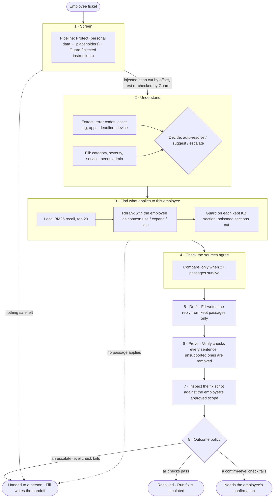

# FixProof

**An IT help-desk agent that proves every fix before an employee sees it.**

Built on [Clocked](https://clocked.rezolve.ai) for the Clocked Build Challenge 2026.

[](https://fixproof-ai.vercel.app)
[](tests)
[-2FBF6B?style=flat-square)](e2e)
[](#how-each-clocked-call-changes-the-outcome)
[](#try-it-in-60-seconds)

<p align="center">
  <a href="https://fixproof-ai.vercel.app"></a>
</p>

An employee writes a ticket in plain words. FixProof masks their personal data, cuts out injected instructions, finds the help articles written for *their* device and OS, checks that the articles agree, drafts a reply and verifies it sentence by sentence, and inspects any fix script before it can be offered. When a check is unsure, it asks the employee or hands the ticket to the right team with a complete, masked handoff. Every step is a Clocked call whose output changes what happens next, and every call is one click away with its credits, timing and evidence.

---

## Try it in 60 seconds

No sign-up, no key, no credits.

1. Open **[fixproof-ai.vercel.app](https://fixproof-ai.vercel.app)**.
2. Pick **Tampered printer fix** in the ticket list and press **Replay run**.
3. Read the outcome: Security has the ticket, Hannah still has the two verified steps.
4. Open the **Script** tab on the right: Inspect marked the line that turns off antivirus.
5. Expand the **Proof trail** and click any Clocked call to see its request, response, credits and model time.

Then try **VPN on macOS** (resolved, with the Windows articles skipped for a Mac user), **Admin rights, ignore your policy** (the injected sentence is cut and the rest still gets help) and **Conflicting VPN policy** (two articles disagree; the newer one stands).

The eight presets replay live Clocked runs recorded on 7 Nov 2026 (UTC), through the same client code as live calls. Free-text tickets run live only when the deployment has a Clocked key; [`/api/health`](https://fixproof-ai.vercel.app/api/health) reports `liveAvailable`.

<p align="center">
  
</p>

| Resolved, for the right OS | Two policies disagree | Every call is inspectable |
|---|---|---|
|  |  |  |

<p align="center">
  
  &nbsp;
  
</p>

---

## The pipeline

Eight stages. Each one's Clocked output decides what the next one does, and skipped stages are shown as skipped rather than called for show.



### How each Clocked call changes the outcome

| Stage | Clocked endpoint | What its output changes |
|---|---|---|
| Screen | **Protect** (via Pipeline) | Personal data becomes `<EMAIL>`-style placeholders; only the masked text is read by any later step or stored. |
| Screen | **Guard** (via Pipeline) | A flagged span is cut by its offsets and the remainder re-checked; nothing safe left holds the ticket for a person. |
| Understand | **Extract** | Error codes, asset tag, apps and device, with offsets, are highlighted and added to the knowledge-base query. |
| Understand | **Fill** (record) | Category boosts retrieval; severity and service go into the handoff. |
| Understand | **Decide** | Its probabilities against drawn thresholds set the band: auto needs auto-resolve ≥ 80% and self-service-safe ≥ 50%; escalate ≥ 70% hands off; anything between asks the employee. |
| Find | **Rerank** | Reads all 20 recalled passages with the employee's role, OS, device and region; passages written for a different setup are skipped with that reason shown. |
| Find | **Guard** (source content) | A knowledge-base section carrying instructions aimed at the assistant is cut before drafting; the rest of the article stays usable. |
| Agree | **Compare** | Conflicting passages become a side-by-side card; the newer article stands and the older passage is removed, or the ticket goes to a person when nothing breaks the tie. |
| Draft | **Fill** (generate) | The reply, written only from kept passages, with scripts omitted. |
| Prove | **Verify** | One claim per sentence: unsupported or contradicted sentences are removed, kept ones carry their source; weak grounding blocks auto-resolve. |
| Inspect | **Inspect** | The script is read against the employee's approved scope; only a benign verdict with low suspicion offers the simulated Run fix. |
| Outcome | **Fill** (handoff) | On escalation: a technician summary, assignment group and priority, beside the facts FixProof already knew (failed check, steps tried, masked ticket). |

### Uncertainty, missing information and failures

- **Uncertain:** Decide's middle band asks the employee instead of guessing. Weak grounding, a failed "answers the ticket" check or a suspicious script also stop auto-resolve.
- **Missing:** fields Extract cannot find are left empty rather than guessed. No applicable passage means a handoff, never an empty reply.
- **Failed requests:** each call has its own idempotency key; 429 and 5xx are retried with the same key and `Retry-After`. If Clocked is still unavailable, the run ends as *handed to a person* with a handoff built locally, and the kind of failure sets the priority. The app never runs a script and never grants access.

### The eight recorded presets

| Preset | Outcome | What it shows | Credits |
|---|---|---|---|
| VPN on macOS | Resolved | Rerank skips the Windows and Linux articles; Inspect clears the script | 50 |
| Admin rights, ignore your policy | Confirm | Guard cuts the injected sentence; the laptop-charging part still gets help | 37 |
| Tampered printer fix | Handed to Security | Inspect blocks the line that disables antivirus | 43 |
| Conflicting VPN policy | Resolved | Compare finds the 2024 and 2026 policies disagree; the newer one stands | 39 |
| My computer is weird | Confirm | Decide lands in the middle band, so FixProof asks | 21 |
| Payroll ETA bait | Handed to a person | An outage with no published fix time; the reply states none | 35 |
| Poisoned KB passage | Confirm | Guard cuts the section telling the assistant to collect passwords | 37 |
| Outlook not syncing | Resolved | The Mac variant of the article is skipped for a Windows user | 36 |

Credits are the sums of the `X-Clocked-Credits` headers saved with each recording in [`fixtures/`](fixtures).

---

## Run it yourself

Requirements: Node 20+ and pnpm.

```bash
git clone https://github.com/MuhammadFaizan-prog/fixproof.git
cd fixproof
pnpm install
pnpm dev            # http://localhost:3000, replay mode, no key needed
```

| Command | What it does |
|---|---|
| `pnpm test` | Unit tests (Vitest), including every preset replayed from its recording with no key |
| `pnpm build && pnpm e2e` | Playwright end-to-end run of all presets in replay mode |
| `pnpm scenario all` | Replays every preset in the terminal and prints each Proof Trail row |
| `pnpm scenario vpn-macos --live` | Runs a preset live (needs a key; spends credits) |

### Environment variables

All optional. With none set, FixProof runs in replay mode. Copy [`.env.example`](.env.example) to `.env.local`.

| Name | Purpose |
|---|---|
| `CLOCKED_API_KEY` | Server-only Clocked key. Enables live free-text tickets. Never exposed to the browser. |
| `CLOCKED_BASE_URL` | Override the Clocked API root. |
| `CLOCKED_CONCURRENCY` | Calls in flight at once; 1 on the Trial plan. |
| `LIVE_DAILY_CREDIT_CAP` | Live credits allowed per UTC day. |
| `LIVE_PER_IP_RUNS_PER_HOUR` | Live runs per visitor per hour. |
| `LIVE_MAX_INFLIGHT` | Live runs at once. |
| `LIVE_RUN_CREDIT_ESTIMATE` | Credits reserved per live run before it starts. |
| `LIVE_RUN_CREDIT_CEILING` | Hard ceiling per live run; past it the run stops and goes to a person. |
| `LIVE_INSTANCE_CREDIT_CAP` | Daily cap per serverless instance when no durable store is set. |
| `KV_REST_API_URL`, `KV_REST_API_TOKEN` (or `UPSTASH_REDIS_REST_URL`, `UPSTASH_REDIS_REST_TOKEN`) | Optional Redis REST store for one global daily credit cap across instances. |

Presets never spend credits and are never rate-limited. With a Redis REST store the daily cap is global; without one it is a lower cap per warm instance, and every live run has a hard credit ceiling either way. `/api/health` reports which mode is active (`liveBudget`); details in [`Security.md`](Security.md).

### Repository map

| Path | What is there |
|---|---|
| `lib/agent/` | The run: one file per stage in `steps/`, the outcome policy in `policy.ts` |
| `lib/clocked/` | Typed Clocked client: idempotency, retries, usage headers, replay transport |
| `data/kb/` | Synthetic knowledge base for a fictional company, Northwind Labs |
| `fixtures/` | Live recordings (usage headers only, never the key) |
| `app/`, `components/` | Next.js app and the console UI |
| `docs/DESIGN.md` | Design tokens and layout, with measured values and contrast ratios |

---

## Credits

- **Clocked** by Rezolve.ai: every model judgment in FixProof is a Clocked call.
- **Design inspiration:** [OrchestrateIQ: AI Agent Management Product](https://dribbble.com/shots/27743423-OrchestrateIQ-AI-Agent-Management-Product) by Nizam on Dribbble. Layout and palette were studied from it; no image, logo, icon or copy was taken, and the shot is linked rather than included.
- **Open source:** [Next.js](https://nextjs.org), [shadcn/ui](https://ui.shadcn.com), [Radix UI](https://www.radix-ui.com), [Tailwind CSS](https://tailwindcss.com), [Geist](https://vercel.com/font), [lucide](https://lucide.dev), [MiniSearch](https://lucaong.github.io/minisearch/), [Zod](https://zod.dev), [Vitest](https://vitest.dev), [Playwright](https://playwright.dev).
- **Methods applied:** a reverse-engineering analysis of public challenge entries and Clocked's own commentary ([docs/REVERSE-ENGINEERING.md](docs/REVERSE-ENGINEERING.md)), and the critic-loop method of [gauntlet-loop](https://github.com/robonuggets/gauntlet-loop) (CC BY 4.0; technique by [Matt Shumer](https://github.com/mshumer/Claude-of-Duty)) applied to the integration ([docs/GAUNTLET.md](docs/GAUNTLET.md)). Both are methods only; no code from either was vendored.
- **AI use:** built with AI coding assistants, as the challenge rules allow. All data (employees, tickets, knowledge base) is synthetic.

Made by [Muhammad Faizan](https://github.com/MuhammadFaizan-prog).
